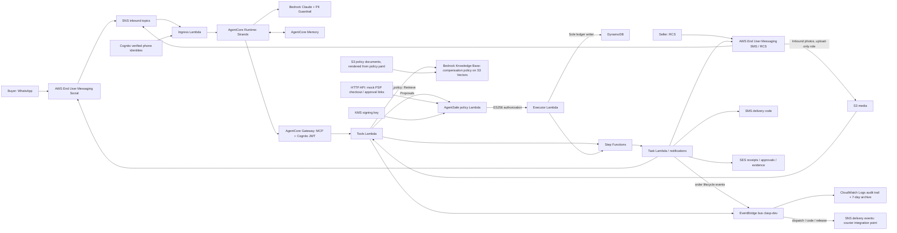

# Architecture

The export reflects the CDK implementation. `demo/export_assets.py` reproduces the PNG.

The Knowledge Base holds the plain-language policy the agent quotes from (`explain_policy`); it is generated from the
same `policy.yaml` that AgentSafe enforces, so the words cannot drift from the numbers. Lifecycle events are
observability and integration hooks, published by the workflow task bodies; they are never on the money path.

The mock PSP records simulated holds and payouts. Actor binding, deterministic policy checks,
signed authorizations and the executor enforce the demo's money boundary. The model's evidence
assessment is a report; it does not itself authorize a refund. Runtime logs use a separate
KMS encryption key and bounded retention.
