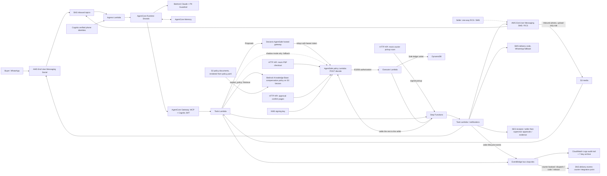

# Architecture

The export reflects the CDK implementation. `demo/export_assets.py` reproduces the PNG.

The Knowledge Base holds the plain-language policy the agent quotes from (`explain_policy`); it is generated from the
same `policy.yaml` that AgentSafe enforces, so the words cannot drift from the numbers. Lifecycle events are
observability and integration hooks, published by the workflow task bodies; they are never on the money path.

The order runs without anyone chatting with the seller: the PSP webhook holds the payment, the courier's
HMAC-signed pickup scan records dispatch, the buyer's code releases the payout, and in-policy Truce outcomes
settle automatically, with the rest of the hold released to the seller as its own AgentSafe decision. Policy
escalations (above the automatic cap, or drift: repeated denials, inconclusive evidence, a policy change, an
off-ladder amount) go to the seller by signed SES link, then to a platform supervisor if the seller rejects or
doesn't answer within 24 hours. Approval links open a confirmation page; only the POST acts.

Every decision passes through the Decionis AgentSafe hosted gateway when `AGENTSAFE_URL` is set. In enforcement it
can block or hold a call; otherwise it records a dossier and relays the call to the token-protected `POST /decide`,
where the reference service decides and signs. If the gateway can't answer, nothing moves: the request is denied,
and payment holds and settlement are retried. Only shadow mode falls back to the reference service.

The mock PSP and courier record simulated holds, pickups and payouts. Actor binding, deterministic policy checks,
signed authorizations and the executor enforce the demo's money boundary. The model's evidence
assessment is a report; it does not itself authorize a refund. Runtime logs use a separate
KMS encryption key and bounded retention.
