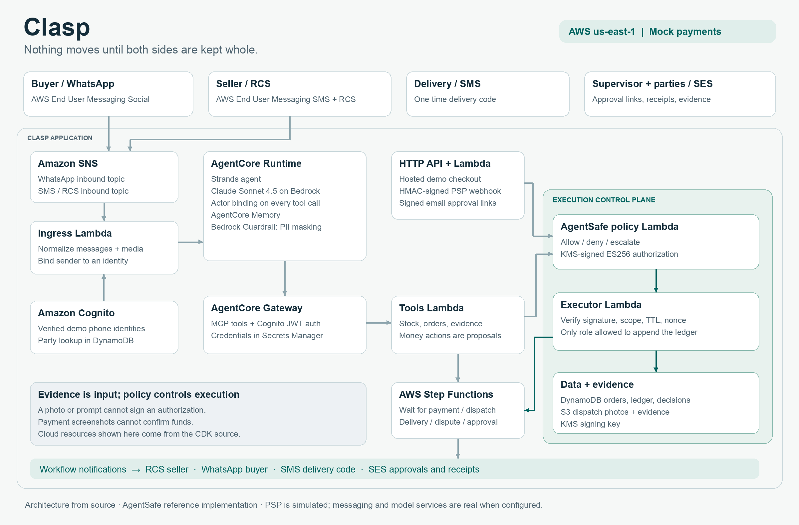
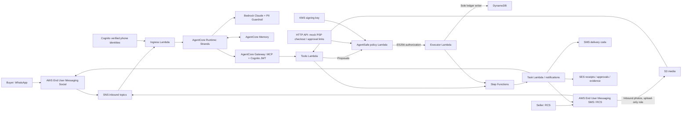

# Architecture

The export reflects the CDK implementation. `demo/export_assets.py` reproduces the PNG.

The mock PSP records simulated holds and payouts. Actor binding, deterministic policy checks,
signed authorizations and the executor enforce the demo's money boundary. The model's evidence
assessment is a report; it does not itself authorize a refund. Runtime logs use a separate
KMS encryption key and bounded retention.
