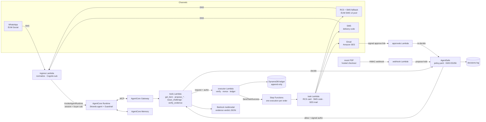

# Architecture

Four channels feed one AgentCore agent. Every money-moving tool call passes through AgentSafe, and only a
signed authorization reaches the executor, which is the only writer of the payout ledger.

`docs/architecture.png` is exported from the submission brief's diagram (TODO(human): export and commit it;
the Devpost architecture field wants the PNG).

## Trust boundary in one paragraph

The agent proposes. AgentSafe decides and signs. The executor verifies and writes. Three roles, three IAM
policies, three code paths, and the tests in `tests/` prove that none of them can do another's job.
